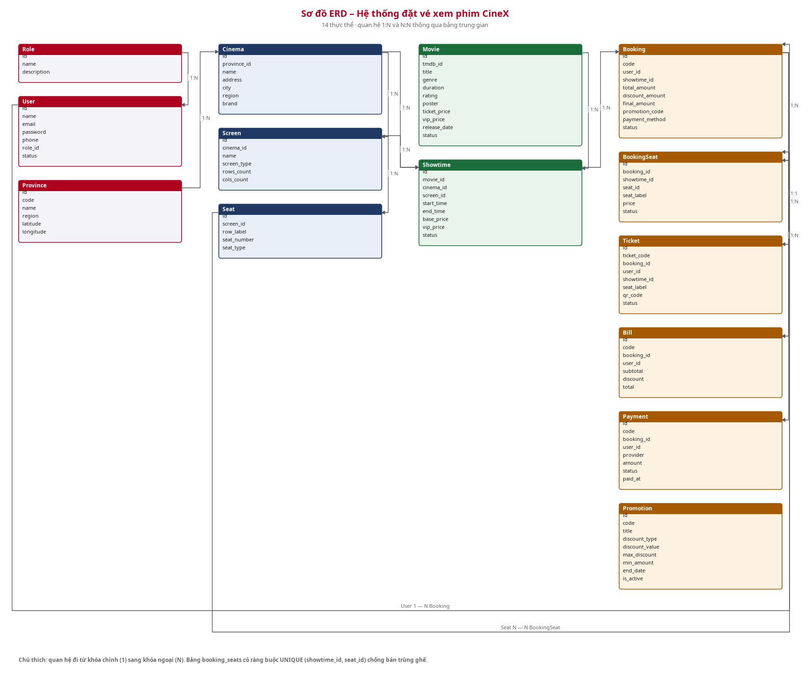
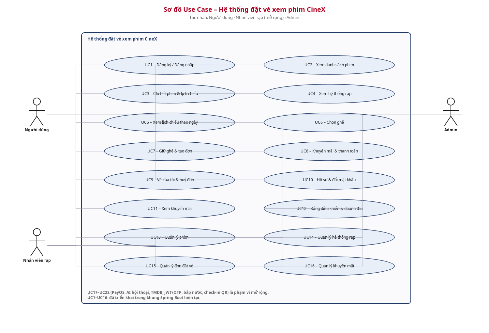
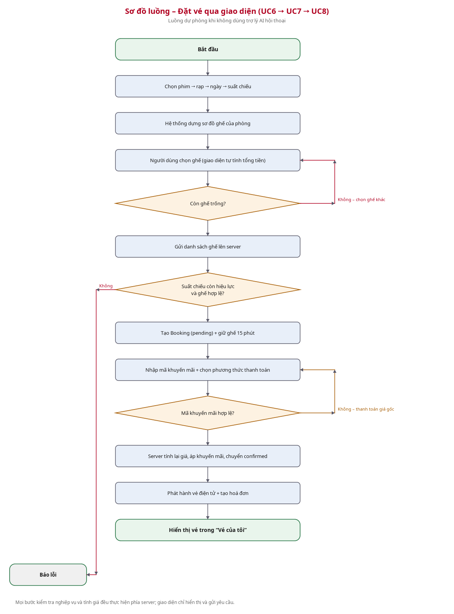
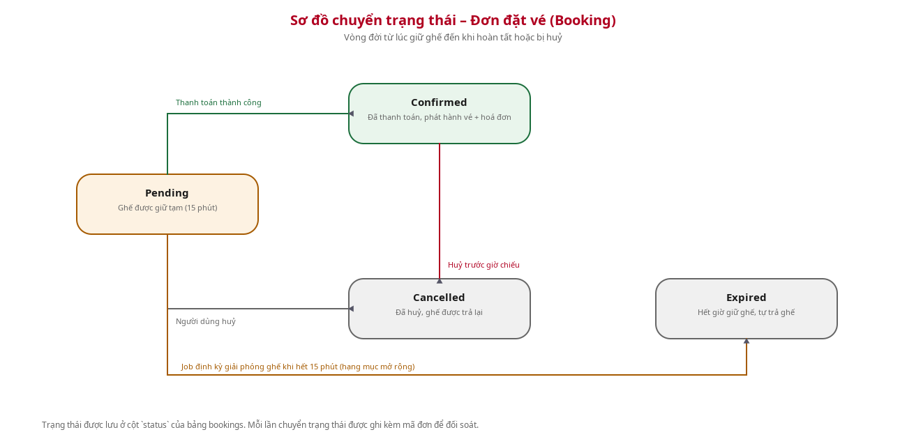
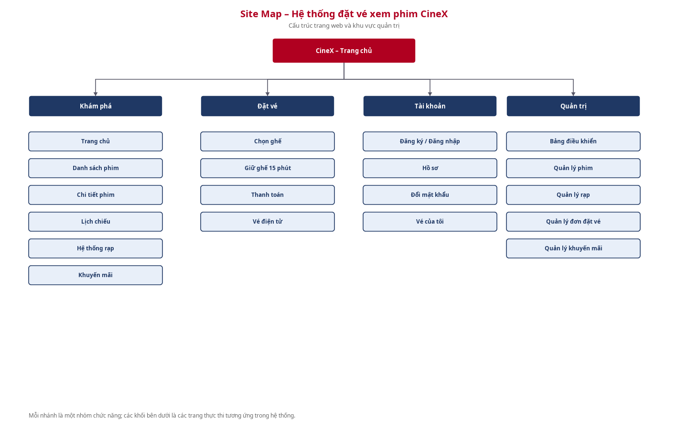

# TÀI LIỆU ĐẶC TẢ YÊU CẦU PHẦN MỀM (SRS)

HỆ THỐNG ĐẶT VÉ XEM PHIM CINEX

(CineX Cinema Booking System - Spring Boot)

| Trường | Nội dung |
|---|---|
| Dự án | Hệ thống đặt vé xem phim CineX (bản Spring Boot) |
| Đơn vị | Học viện Công nghệ Bưu chính Viễn thông – Khoa Công nghệ Thông tin |
| Người thực hiện | Hoàng Văn Chung – D24TX |
| Ngày cập nhật | 20/10/2026 |
| Mã tài liệu | SRS-CINEX-SB-2026-001 |
| Phiên bản | 1.0 |
| Trạng thái | DRAFT – khung nghiệp vụ lõi đã hiện thực, tích hợp ngoài chờ cấu hình |

### Lịch sử phiên bản

| Phiên bản | Ngày | Người thực hiện | Nội dung |
|---|---|---|---|
| 1.0 | 20/10/2026 | Hoàng Văn Chung | Khởi tạo SRS cho bản Spring Boot: đặc tả 16 use case đã hiện thực và 6 use case mở rộng |

### Tài liệu liên quan, tham khảo

| Ngày | Tên tài liệu | Nguồn |
|---|---|---|
| 20/10/2026 | SRS_DatVePhimAI_v2.2_CapNhatTheoDuAn.docx | Nội bộ – bản SRS của hệ thống Express/React |
| 20/10/2026 | Mã nguồn dự án project 19-23 (Spring Boot) | Nội bộ |
| — | Tài liệu Spring Boot 3.5 Reference Documentation | docs.spring.io |
| — | Tài liệu Thymeleaf + Spring Security 6 | thymeleaf.org / spring.io |

---

## MỤC LỤC

| Phần | Nội dung |
|---|---|
| PHẦN 1 | GIỚI THIỆU |
| PHẦN 2 | YÊU CẦU TỔNG THỂ |
| PHẦN 3 | CHỨC NĂNG (UC1 – UC22) |
| PHẦN 4 | CÁC COMPONENT, THÔNG BÁO, CẢNH BÁO |
| PHẦN 5 | YÊU CẦU PHI CHỨC NĂNG TỔNG THỂ |
| PHẦN 6 | ĐỐI CHIẾU TRIỂN KHAI |
| PHẦN 7 | ĐỐI CHIẾU VỚI HỆ THỐNG EXPRESS/REACT |

---

## PHẦN 1: GIỚI THIỆU

### 1.1 Mục đích tài liệu

Tài liệu này đặc tả chi tiết các yêu cầu chức năng và phi chức năng của “Hệ thống Đặt vé Xem phim CineX” bản triển khai bằng Spring Boot. Tài liệu làm cơ sở để hiểu đúng nghiệp vụ, thiết kế giao diện và cơ sở dữ liệu, cài đặt hệ thống, đồng thời là căn cứ để kiểm thử và nghiệm thu sản phẩm.

Tài liệu được đối chiếu trực tiếp với mã nguồn hiện có trong thư mục `project 19-23`, nhằm bảo đảm mọi hạng mục ghi trong đặc tả đều có dấu vết cài đặt hoặc được đánh dấu rõ ràng là hạng mục mở rộng.

### 1.2 Phạm vi tài liệu

Tài liệu bao gồm: sơ đồ ERD, đặc tả use case, sơ đồ luồng, sơ đồ chuyển trạng thái đơn đặt vé, phân quyền, site map, danh mục thông báo/cảnh báo, yêu cầu phi chức năng và bảng đối chiếu triển khai.

**Phạm vi nghiệp vụ:** hệ thống phục vụ **một chuỗi rạp duy nhất** (thương hiệu CineX). Không liên kết, đối soát hay hiển thị dữ liệu của các chuỗi rạp khác; toàn bộ rạp trong hệ thống cùng thuộc một thương hiệu và dùng chung hệ thống lịch chiếu, giá vé và khuyến mãi.

**Hệ thống là website đặt vé trực tuyến**, không phải hệ thống quản lý vận hành rạp, không xử lý bán vé tại quầy và không xử lý quét vé (check-in) trong phạm vi hiện hành.

### 1.3 Tổng quan ứng dụng

Người dùng truy cập website để xem phim đang chiếu và sắp chiếu, tra cứu lịch chiếu theo ngày hoặc theo rạp, chọn ghế trên sơ đồ thật của phòng chiếu, giữ ghế trong thời gian chờ, áp dụng mã khuyến mãi, thanh toán và quản lý vé của mình. Quản trị viên theo dõi hoạt động của chuỗi rạp gồm phim, rạp, lịch chiếu, đơn đặt vé, khuyến mãi và doanh thu.

**Backend:** Spring Boot 3.5.16, Java 17, Spring Web MVC, Spring Security 6 (form login + session), Spring Data JPA / Hibernate 6. Cung cấp REST API `/api/**` và các trang web server-side render.

**Frontend:** Thymeleaf 3.1 + thymeleaf-extras-springsecurity6, CSS thuần theo chủ đề tối, JavaScript cho thao tác chọn ghế. Không cần Node.js khi triển khai.

**Cơ sở dữ liệu:** MySQL 8, 14 bảng, schema do `database/init.sql` quản lý, Hibernate dùng `ddl-auto=validate` nên không tự sửa cấu trúc bảng.

**Triển khai:** Docker Compose gồm 3 dịch vụ – MySQL (mạng nội bộ, không publish cổng), Spring Boot (build multi-stage Gradle 8.14 + JDK 17 → JRE 17) và Nginx làm reverse proxy.

**Tích hợp bên ngoài (chờ cấu hình):** TMDB (đồng bộ phim), YouTube Data API (trailer), PayOS (thanh toán online), NVIDIA NIM (trợ lý AI), Google OAuth và Firebase. Khung đã có sẵn cấu hình đọc biến môi trường tại `com.cinex.config.IntegrationProperties`.

### 1.4 Thuật ngữ viết tắt

| STT | Từ viết tắt | Diễn giải |
|---|---|---|
| 1 | SRS | Software Requirements Specification – Tài liệu đặc tả yêu cầu phần mềm |
| 2 | UC | Use Case – Ca sử dụng |
| 3 | ERD | Entity Relationship Diagram – Sơ đồ quan hệ thực thể |
| 4 | JPA | Java Persistence API – Chuẩn ánh xạ quan hệ đối tượng sang bảng quan hệ |
| 5 | ORM | Object-Relational Mapping – Ánh xạ đối tượng Java sang bảng cơ sở dữ liệu |
| 6 | MVC | Model – View – Controller, mô hình kiến trúc của Spring Web |
| 7 | SSR | Server-Side Rendering – Kỹ thuật render giao diện phía máy chủ |
| 8 | CSRF | Cross-Site Request Forgery – Tấn công giả mạo yêu cầu chéo trang |
| 9 | BCrypt | Hàm băm mật khẩu có salt tích hợp, dùng bởi Spring Security |
| 10 | Docker | Nền tảng đóng gói và chạy ứng dụng dưới dạng container |
| 11 | Held / Confirmed / Cancelled | Các trạng thái của một đơn đặt vé (Booking) |

---

## PHẦN 2: YÊU CẦU TỔNG THỂ

### 2.1 Sơ đồ quan hệ đối tượng (ERD)

| Thực thể (Entity) | Các thuộc tính chính | Ý nghĩa |
|---|---|---|
| Role | id, name, description | Vai trò của tài khoản: admin / user / staff |
| User | id, name, email, password, phone, avatar, role_id, status, created_at | Tài khoản người dùng hoặc quản trị viên |
| Province | id, code, name, region, latitude, longitude | Tỉnh/thành phố, phục vụ nhóm rạp và định vị |
| Cinema | id, province_id, name, address, phone, lat, lng, district, city, region, brand, status | Chi nhánh rạp thuộc chuỗi CineX |
| Screen | id, cinema_id, name, screen_type, rows_count, cols_count | Phòng chiếu thuộc một rạp |
| Seat | id, screen_id, row_label, seat_number, seat_type, is_active | Ghế thuộc bố cục cố định của phòng (thường / VIP) |
| Movie | id, tmdb_id, title, original_title, genre, duration, rating, poster, backdrop, director, cast_members, description, release_date, ticket_price, vip_price, trailer_url, language, popularity, status | Thông tin phim |
| Showtime | id, movie_id, cinema_id, screen_id, start_time, end_time, base_price, vip_price, status | Suất chiếu của một phim tại một phòng |
| Booking | id, code, user_id, showtime_id, total_amount, discount_amount, final_amount, promotion_code, payment_method, status | Đơn đặt vé |
| BookingSeat | id, booking_id, showtime_id, seat_id, seat_label, price, status | Ghế thuộc một đơn đặt vé; UNIQUE (showtime_id, seat_id) chống bán trùng ghế |
| Ticket | id, ticket_code, booking_id, user_id, showtime_id, seat_label, qr_code, status, used_at | Vé điện tử phát hành sau khi thanh toán hợp lệ |
| Bill | id, code, booking_id, user_id, subtotal, discount, total, issued_at | Hoá đơn của đơn đặt vé |
| Payment | id, code, booking_id, user_id, provider, amount, status, provider_order_id, provider_ref, paid_at | Giao dịch thanh toán |
| Promotion | id, code, title, description, discount_type, discount_value, max_discount, min_amount, start_date, end_date, usage_limit, used_count, is_active | Chương trình khuyến mãi |

Các quan hệ chính (relationships):

• Role (1) — (N) User: một vai trò phục vụ nhiều tài khoản.

• Province (1) — (N) Cinema: một tỉnh/thành có nhiều chi nhánh rạp.

• Cinema (1) — (N) Screen: một rạp có nhiều phòng chiếu.

• Screen (1) — (N) Seat và Screen (1) — (N) Showtime: bố cục ghế và lịch chiếu gắn với phòng.

• Movie (1) — (N) Showtime: một phim có nhiều suất chiếu.

• User (1) — (N) Booking: một người dùng có nhiều đơn đặt vé.

• Showtime (1) — (N) Booking: một suất chiếu có nhiều đơn đặt vé.

• Booking (N) — (N) Seat thông qua BookingSeat.

• Booking (1) — (1) Bill: mỗi đơn đặt vé có đúng một hoá đơn.

• Booking (1) — (N) Payment: có thể có nhiều lần thử thanh toán.

• Booking (1) — (N) Ticket: mỗi ghế trong đơn tương ứng một vé điện tử.

### 2.2 Sơ đồ Use Case

Hệ thống có 3 tác nhân: **Người dùng** (đăng ký, xem phim, đặt vé, quản lý vé của mình), **Nhân viên rạp** (vai trò `staff`, đã có trong bảng dữ liệu) và **Admin** (quản lý phim, rạp, suất chiếu, khuyến mãi, người dùng và theo dõi đơn đặt vé).

| Mã | Tên chức năng | Phân hệ | Tác nhân | Trạng thái |
|---|---|---|---|---|
| UC1 | Đăng ký / Đăng nhập / Đăng xuất | Tài khoản | Người dùng, Admin | Đã triển khai |
| UC2 | Xem danh sách phim & tìm kiếm | Xem phim | Người dùng | Đã triển khai |
| UC3 | Xem chi tiết phim & lịch chiếu của phim | Xem phim | Người dùng | Đã triển khai |
| UC4 | Xem hệ thống rạp & lịch chiếu tại rạp | Xem phim | Người dùng | Đã triển khai |
| UC5 | Xem lịch chiếu theo ngày | Xem phim | Người dùng | Đã triển khai |
| UC6 | Chọn ghế trên sơ đồ phòng | Đặt vé | Người dùng | Đã triển khai |
| UC7 | Giữ ghế & tạo đơn đặt vé | Đặt vé | Người dùng | Đã triển khai |
| UC8 | Áp dụng khuyến mãi & thanh toán | Thanh toán | Người dùng | Đã triển khai |
| UC9 | Xem vé của tôi & huỷ đơn | Tài khoản | Người dùng | Đã triển khai |
| UC10 | Quản lý hồ sơ & đổi mật khẩu | Tài khoản | Người dùng | Đã triển khai |
| UC11 | Xem khuyến mãi | Khuyến mãi | Người dùng | Đã triển khai |
| UC12 | Xem bảng điều khiển & báo cáo doanh thu | Quản trị | Admin | Đã triển khai |
| UC13 | Quản lý phim | Quản trị | Admin | Đã triển khai |
| UC14 | Quản lý hệ thống rạp | Quản trị | Admin | Đã triển khai |
| UC15 | Quản lý đơn đặt vé | Quản trị | Admin | Đã triển khai |
| UC16 | Quản lý khuyến mãi | Quản trị | Admin | Đã triển khai |
| UC17 | Thanh toán online PayOS | Thanh toán | Người dùng | Mở rộng |
| UC18 | Trợ lý AI hội thoại (NVIDIA NIM) | Đặt vé | Người dùng | Mở rộng |
| UC19 | Đồng bộ phim từ TMDB & tìm trailer YouTube | Xem phim | Admin | Mở rộng |
| UC20 | API JWT + xác thực OTP / OAuth | Tài khoản | Người dùng, Admin | Mở rộng |
| UC21 | Bán kèm bắp nước / dịch vụ đi kèm | Đặt vé | Người dùng, Admin | Mở rộng |
| UC22 | Quét vé điện tử tại rạp (check-in) | Vận hành rạp | Nhân viên rạp | Mở rộng |

### 2.3 Sơ đồ luồng

Luồng đặt vé cốt lõi (UC6 → UC7 → UC8):

1. Người dùng chọn suất chiếu từ trang chủ / trang phim / trang lịch chiếu.

2. Hệ thống dựng sơ đồ ghế của phòng và đánh dấu ghế đã bán hoặc đang giữ.

3. Người dùng chọn ghế; giao diện tự tính tổng tiền tạm tính.

4. Gửi danh sách ghế lên server; server kiểm tra suất chiếu và ghế, tạo đơn ở trạng thái pending.

5. Người dùng nhập mã khuyến mãi (nếu có) và chọn phương thức thanh toán.

6. Server tính lại giá, áp khuyến mãi, chuyển đơn sang confirmed, phát hành vé và hoá đơn.

### 2.4 Sơ đồ chuyển trạng thái

Vòng đời của một đơn đặt vé (Booking):

| Trạng thái | Mô tả | Chuyển đến |
|---|---|---|
| Pending | Ghế đã được giữ tạm sau khi tạo đơn (15 phút) | Confirmed (thanh toán), Cancelled (huỷ) |
| Confirmed | Đã thanh toán thành công, đã phát hành vé và hoá đơn | Cancelled (huỷ trước giờ chiếu) |
| Cancelled | Đơn bị huỷ, ghế được trả lại cho suất chiếu | (kết thúc) |

### 2.5 Phân quyền

#### 2.5.1 Phân quyền chức năng

| Chức năng | Người dùng | Nhân viên rạp | Admin |
|---|---|---|---|
| Xem danh sách phim / lịch chiếu / hệ thống rạp | X | X | X |
| Đặt vé (chọn ghế, giữ ghế, thanh toán) | X | X (thay khách) | — |
| Áp dụng khuyến mãi | X | — | — |
| Huỷ đơn đặt vé | X (đơn của mình) | — | — |
| Xem lịch sử đặt vé và vé của mình | X | — | — |
| Quản lý hồ sơ, đổi mật khẩu | X | — | X |
| Quản lý phim / rạp / phòng / ghế / suất chiếu | — | — | X |
| Quản lý khuyến mãi và người dùng | — | — | X |
| Xem báo cáo doanh thu và thống kê hoạt động | — | — | X |

#### 2.5.2 Phân quyền dữ liệu

| Đối tượng dữ liệu | Người dùng | Nhân viên rạp | Admin |
|---|---|---|---|
| Booking (đơn đặt vé) | Chỉ đọc/sửa đơn của mình | Đọc đơn theo suất phụ trách | Toàn quyền đọc/sửa |
| Users (hồ sơ) | Chỉ sửa hồ sơ của mình | Không truy cập hồ sơ khách | Toàn quyền quản lý tài khoản |
| Dữ liệu phim / suất chiếu / ghế | Chỉ đọc | Chỉ đọc | Toàn quyền tạo/sửa/xoá |
| Khuyến mãi | Chỉ đọc và áp dụng khi thanh toán | Không áp dụng | Toàn quyền quản lý |
| Cấu hình tích hợp ngoài / khoá API | Không truy cập | Không truy cập | Chỉ đọc trạng thái đã cấu hình |

### 2.6 Site Map

• Trang chủ (phim đang chiếu / sắp chiếu / lịch chiếu hôm nay / khuyến mãi / hệ thống rạp)

• → Danh sách phim (tìm kiếm, phân trang) → Chi tiết phim → Chọn suất chiếu

• → Hệ thống rạp (nhóm theo tỉnh/thành) → Chi tiết rạp (lịch chiếu tại rạp)

• → Lịch chiếu (lọc theo ngày 1/3/7 ngày và theo rạp)

• → Chọn ghế (sơ đồ phòng) → Thanh toán (khuyến mãi + phương thức thanh toán) → Vé điện tử

• Tài khoản: Đăng ký / Đăng nhập → Hồ sơ (đổi mật khẩu) → Vé của tôi (lịch sử, huỷ đơn)

• Khu vực Admin: Bảng điều khiển (doanh thu) → Quản lý phim / rạp / đơn đặt vé / khuyến mãi

---

## PHẦN 3: CHỨC NĂNG

### 3.1. UC1 — Đăng ký / Đăng nhập / Đăng xuất

#### 3.1.1. Đặc tả Use Case

| Thuộc tính | Nội dung |
|---|---|
| Use Case ID | UC1 |
| Mô tả | Người dùng tạo tài khoản mới hoặc đăng nhập để sử dụng hệ thống; phiên đăng nhập được thiết lập bằng session phía máy chủ. |
| Tác nhân (Actor(s)) | Người dùng, Admin |
| Sự ưu tiên (Priority) | Cao |
| Trigger | Người dùng truy cập trang Đăng ký hoặc Đăng nhập |
| Điều kiện cần (Pre-Condition) | Đăng ký: email và số điện thoại chưa tồn tại. Đăng nhập: tài khoản đã tồn tại và còn hiệu lực. |
| Điều kiện sau (Post-Condition(s)) | Phiên đăng nhập được thiết lập, cookie phiên (JSESSIONID) được cấp; người dùng được điều hướng theo vai trò. |
| Luồng cơ bản (Basic Flow) | 1. Đăng ký: nhập họ tên, email, số điện thoại, mật khẩu và xác nhận mật khẩu → kiểm tra trùng email/số điện thoại → băm mật khẩu bằng BCrypt → tạo User với role = user. 2. Đăng nhập: nhập email và mật khẩu → Spring Security xác thực → thiết lập session → điều hướng theo vai trò (quản trị về /admin, người dùng về trang chủ). 3. Đăng xuất: gửi POST /logout → vô hiệu hoá session, xoá cookie phiên → chuyển về trang chủ. |
| Luồng thay thế (Alternative Flow) | A1 — Người dùng đã đăng nhập thì truy cập /login hoặc /register được chuyển hướng về trang chủ. |
| Luồng ngoại lệ (Exception Flow) | E1 — Email đã tồn tại → hiển thị lỗi tại trường nhập, không tạo tài khoản. E2 — Số điện thoại đã tồn tại → hiển thị lỗi tại trường nhập. E3 — Mật khẩu xác nhận không khớp → hiển thị lỗi. E4 — Sai email/mật khẩu → chuyển về /login?error kèm thông báo chung, không tiết lộ thông tin tài khoản. E5 — Tài khoản bị khoá (status = blocked) → từ chối đăng nhập. |
| Ràng buộc (Business Rules) | Email và số điện thoại là duy nhất; mật khẩu tối thiểu 6 ký tự; số điện thoại theo định dạng Việt Nam; mật khẩu luôn được lưu ở dạng băm BCrypt. |
| Yêu cầu phi chức năng (Non-Functional Requirement) | Bảo vệ CSRF tự động trên mọi biểu mẫu POST; mật khẩu không bao giờ lưu dạng plaintext; phiên hết hạn sau 60 phút không hoạt động. |

#### 3.1.2. Sơ đồ luồng chi tiết

Truy cập biểu mẫu → validate phía server → kiểm tra trùng lặp → băm mật khẩu → tạo tài khoản hoặc xác thực → thiết lập session → điều hướng theo vai trò.

#### 3.1.3. Giao diện

Trang đăng nhập và đăng ký trung tâm, validate tại server, hiển thị lỗi rõ ràng dưới từng trường, kèm khối gợi ý tài khoản demo.

#### 3.1.4. Mô tả chi tiết

| Tên tiếng Việt | Tên tiếng Anh | Loại | Bắt buộc? | Mô tả |
|---|---|---|---|---|
| Họ và tên | name | Text | Có | Tên hiển thị, tối đa 100 ký tự |
| Email | email | Email | Có | Địa chỉ email, duy nhất, tối đa 100 ký tự |
| Số điện thoại | phone | Text | Có | Duy nhất, định dạng 0xx… hoặc +84xx… |
| Mật khẩu | password | Password | Có | Tối thiểu 6 ký tự |
| Xác nhận mật khẩu | confirmPassword | Password | Có | Phải khớp với mật khẩu |

### 3.2. UC2 — Xem danh sách phim & tìm kiếm

#### 3.2.1. Đặc tả Use Case

| Thuộc tính | Nội dung |
|---|---|
| Use Case ID | UC2 |
| Mô tả | Người dùng xem toàn bộ phim đang chiếu và sắp chiếu, tìm kiếm theo tên hoặc thể loại và duyệt theo trang. |
| Tác nhân (Actor(s)) | Người dùng |
| Sự ưu tiên (Priority) | Cao |
| Trigger | Người dùng truy cập trang Danh sách phim |
| Điều kiện cần (Pre-Condition) | Có dữ liệu phim hợp lệ trong hệ thống |
| Điều kiện sau (Post-Condition(s)) | Hiển thị danh sách phim kèm poster, thể loại, thời lượng, phân loại giới hạn độ tuổi |
| Luồng cơ bản (Basic Flow) | 1. Hệ thống truy vấn phim có trạng thái active, sắp xếp theo độ phủ giảm dần. 2. Người dùng nhập từ khoá → hệ thống lọc theo tên phim hoặc thể loại (không phân biệt hoa thường). 3. Danh sách được chia trang 12 phim/trang, người dùng chuyển trang bằng nút trước/sau. |
| Luồng thay thế (Alternative Flow) | A1 — Bỏ trống từ khoá → hiển thị toàn bộ phim đang chiếu. A2 — Không có kết quả → hiển thị trạng thái rỗng kèm hướng dẫn. |
| Luồng ngoại lệ (Exception Flow) | E1 — Từ khoá chứa ký tự đặc biệt không được hỗ trợ → xử lý như từ khoá thông thường, không lỗi. |
| Ràng buộc (Business Rules) | Chỉ hiển thị phim có trạng thái active; tìm kiếm không phân biệt hoa thường; phân trang mặc định 12 bản ghi/trang. |
| Yêu cầu phi chức năng (Non-Functional Requirement) | Truy vấn phân trang chạy ở mức cơ sở dữ liệu (không tải toàn bộ bảng); trang phải phản hồi dưới 2 giây. |

#### 3.2.2. Sơ đồ luồng chi tiết

Mở trang phim → nhập từ khoá (tuỳ chọn) → truy vấn Movie có phân trang → hiển thị lưới poster → chọn phim → sang UC3.

#### 3.2.3. Giao diện

Lưới poster phim, ô tìm kiếm, điều hướng phân trang, huy hiệu phân loại giới hạn độ tuổi và thời lượng.

#### 3.2.4. Mô tả chi tiết

| Tên tiếng Việt | Tên tiếng Anh | Loại | Bắt buộc? | Mô tả |
|---|---|---|---|---|
| Từ khoá | q | Text | Không | Tìm theo tên phim hoặc thể loại |
| Số trang | page | Number | Không | Chỉ số trang, bắt đầu từ 0 |

### 3.3. UC3 — Xem chi tiết phim & lịch chiếu của phim

#### 3.3.1. Đặc tả Use Case

| Thuộc tính | Nội dung |
|---|---|
| Use Case ID | UC3 |
| Mô tả | Người dùng xem thông tin đầy đủ của một bộ phim và danh sách suất chiếu còn có thể đặt vé. |
| Tác nhân (Actor(s)) | Người dùng |
| Sự ưu tiên (Priority) | Cao |
| Trigger | Người dùng chọn một phim từ trang danh sách hoặc trang chủ |
| Điều kiện cần (Pre-Condition) | Phim tồn tại và có trạng thái active |
| Điều kiện sau (Post-Condition(s)) | Hiển thị nội dung phim kèm lịch chiếu theo rạp, phòng và giờ chiếu |
| Luồng cơ bản (Basic Flow) | 1. Hệ thống tải phim theo id cùng toàn bộ suất chiếu sắp tới của phim. 2. Hiển thị poster, tiêu đề, đạo diễn, diễn viên, thể loại, thời lượng, mô tả, ngày phát hành, giá vé thường và giá VIP, đường dẫn trailer. 3. Danh sách suất chiếu hiển thị rạp, phòng, khung giờ bắt đầu – kết thúc và ngày chiếu. 4. Chọn suất chiếu → chuyển sang UC6 (chọn ghế). |
| Luồng thay thế (Alternative Flow) | A1 — Phim chưa có trailer → ẩn nút xem trailer. A2 — Phim chưa có suất chiếu → hiển thị trạng thái rỗng kèm hướng dẫn. |
| Luồng ngoại lệ (Exception Flow) | E1 — Không tìm thấy phim → chuyển về trang chủ kèm thông báo “Không tìm thấy phim”. |
| Ràng buộc (Business Rules) | Chỉ hiển thị suất chiếu chưa diễn ra; giá vé hiển thị theo giá của suất chiếu, không dùng giá cố định toàn cục. |
| Yêu cầu phi chức năng (Non-Functional Requirement) | Chi tiết phim phải phản hồi dưới 2 giây; ảnh poster tải lazy và có kích thước dự trữ để tránh nhảy layout. |

#### 3.3.2. Sơ đồ luồng chi tiết

Chọn phim → tải phim và suất chiếu → hiển thị trang chi tiết → chọn suất → sang UC6.

#### 3.3.3. Giao diện

Cột poster bên trái, thông tin phim và bảng đặc tính bên phải, khối lịch chiếu dạng danh sách nút giờ chiếu ở cuối trang.

#### 3.3.4. Mô tả chi tiết

| Tên tiếng Việt | Tên tiếng Anh | Loại | Bắt buộc? | Mô tả |
|---|---|---|---|---|
| Mã phim | id | Number | Có | Định danh phim trong đường dẫn /movies/{id} |

### 3.4. UC4 — Xem hệ thống rạp & lịch chiếu tại rạp

#### 3.4.1. Đặc tả Use Case

| Thuộc tính | Nội dung |
|---|---|
| Use Case ID | UC4 |
| Mô tả | Người dùng xem toàn bộ chi nhánh rạp của chuỗi CineX theo tỉnh/thành và xem lịch chiếu riêng của một chi nhánh. |
| Tác nhân (Actor(s)) | Người dùng |
| Sự ưu tiên (Priority) | Trung bình |
| Trigger | Người dùng truy cập trang Rạp chiếu phim |
| Điều kiện cần (Pre-Condition) | Có dữ liệu chi nhánh rạp hợp lệ |
| Điều kiện sau (Post-Condition(s)) | Hiển thị các chi nhánh theo tỉnh/thành và lịch chiếu của chi nhánh được chọn |
| Luồng cơ bản (Basic Flow) | 1. Hệ thống tải toàn bộ chi nhánh có trạng thái active, nhóm theo tỉnh/thành. 2. Hiển thị tên chi nhánh, địa chỉ, thương hiệu và thành phố. 3. Chọn một chi nhánh → xem lịch chiếu sắp tới tại rạp đó (phim, phòng, giờ, ngày). |
| Luồng thay thế (Alternative Flow) | A1 — Chi nhánh chưa có suất chiếu → hiển thị trạng thái rỗng. |
| Luồng ngoại lệ (Exception Flow) | E1 — Không tìm thấy chi nhánh → chuyển về trang chủ kèm thông báo. |
| Ràng buộc (Business Rules) | Toàn bộ rạp trong hệ thống cùng thuộc thương hiệu CineX; hệ thống không hiển thị rạp của chuỗi khác; chỉ hiển thị suất chiếu chưa diễn ra. |
| Yêu cầu phi chức năng (Non-Functional Requirement) | Trang rạp phải phản hồi dưới 3 giây với 45 chi nhánh; dùng phân trang hoặc nhóm theo tỉnh để giữ trang nhẹ. |

#### 3.4.2. Sơ đồ luồng chi tiết

Mở trang rạp → nhóm theo tỉnh → chọn chi nhánh → xem lịch chiếu → chọn suất → sang UC6.

#### 3.4.3. Giao diện

Tiêu đề theo tỉnh/thành, lưới thẻ rạp; trang chi tiết rạp có danh sách nút giờ chiếu.

#### 3.4.4. Mô tả chi tiết

| Tên tiếng Việt | Tên tiếng Anh | Loại | Bắt buộc? | Mô tả |
|---|---|---|---|---|
| Mã rạp | id | Number | Có | Định danh chi nhánh trong /cinemas/{id} |

### 3.5. UC5 — Xem lịch chiếu theo ngày

#### 3.5.1. Đặc tả Use Case

| Thuộc tính | Nội dung |
|---|---|
| Use Case ID | UC5 |
| Mô tả | Người dùng xem lịch chiếu theo ngày, lọc theo khoảng 1–7 ngày và theo chi nhánh rạp. |
| Tác nhân (Actor(s)) | Người dùng |
| Sự ưu tiên (Priority) | Cao |
| Trigger | Người dùng truy cập trang Lịch chiếu |
| Điều kiện cần (Pre-Condition) | Có dữ liệu suất chiếu tương lai |
| Điều kiện sau (Post-Condition(s)) | Hiển thị lịch chiếu theo từng ngày, nhóm theo chi nhánh |
| Luồng cơ bản (Basic Flow) | 1. Mặc định lấy lịch chiếu của ngày hôm nay, cho phép chọn khoảng 1, 3 hoặc 7 ngày. 2. Người dùng chọn chi nhánh trong hộp chọn để lọc; có thể chọn ngày bắt đầu. 3. Suất chiếu được nhóm theo ngày, mỗi ngày nhóm theo chi nhánh, mỗi chi nhánh là danh sách nút giờ. 4. Chọn giờ chiếu → sang UC6. |
| Luồng thay thế (Alternative Flow) | A1 — Bỏ chọn chi nhánh → hiển thị lịch chiếu của toàn bộ chuỗi rạp. A2 — Không có suất chiếu trong khoảng đã chọn → hiển thị trạng thái rỗng. |
| Luồng ngoại lệ (Exception Flow) | E1 — Ngày chọn không hợp lệ → hệ thống dùng ngày hiện tại. |
| Ràng buộc (Business Rules) | Chỉ hiển thị suất chiếu có trạng thái scheduled và còn nằm trong khoảng thời gian đã chọn; khoảng lọc tối đa 7 ngày để bảo đảm hiệu năng. |
| Yêu cầu phi chức năng (Non-Functional Requirement) | Phản hồi dưới 2 giây; khoảng lọc mặc định 1 ngày để trang luôn nhẹ. |

#### 3.5.2. Sơ đồ luồng chi tiết

Mở trang lịch chiếu → chọn ngày/khoảng ngày → chọn rạp → truy vấn suất chiếu → nhóm theo ngày → chọn giờ → sang UC6.

#### 3.5.3. Giao diện

Thanh bộ lọc (ngày, khoảng ngày, rạp), các nhóm ngày với tiêu đề thứ – ngày và lưới nút giờ.

#### 3.5.4. Mô tả chi tiết

| Tên tiếng Việt | Tên tiếng Anh | Loại | Bắt buộc? | Mô tả |
|---|---|---|---|---|
| Ngày bắt đầu | date | Date | Không | Mặc định ngày hiện tại |
| Số ngày | days | Select | Không | 1, 3 hoặc 7 ngày |
| Chi nhánh rạp | cinemaId | Select | Không | Lọc theo rạp, mặc định tất cả |

### 3.6. UC6 — Chọn ghế trên sơ đồ phòng

#### 3.6.1. Đặc tả Use Case

| Thuộc tính | Nội dung |
|---|---|
| Use Case ID | UC6 |
| Mô tả | Người dùng xem sơ đồ ghế thật của phòng chiếu, chọn ghế trống và theo dõi tổng tiền tạm tính. |
| Tác nhân (Actor(s)) | Người dùng |
| Sự ưu tiên (Priority) | Cao |
| Trigger | Người dùng chọn một suất chiếu |
| Điều kiện cần (Pre-Condition) | Suất chiếu còn hiệu lực; người dùng đã đăng nhập nếu muốn tiến hành đặt vé |
| Điều kiện sau (Post-Condition(s)) | Danh sách ghế đã chọn và tổng tiền tạm tính hiển thị trên giao diện |
| Luồng cơ bản (Basic Flow) | 1. Hệ thống truy vấn bố cục ghế của phòng (theo hàng A..H, số ghế tăng dần) kèm trạng thái ghế đã bán hoặc đang giữ của suất chiếu. 2. Ghế được phân loại: ghế thường (màu trung tính) và ghế VIP (2 hàng cuối, viền xanh). 3. Người dùng bấm ghế trống → ghế chuyển sang trạng thái đang chọn; bấm lần nữa để bỏ chọn. 4. Tổng tiền và số ghế được cập nhật tức thời; nút thanh toán chỉ kích hoạt khi có ít nhất 1 ghế. |
| Luồng thay thế (Alternative Flow) | A1 — Ghế đã bán → bấm không có hiệu lực, hiển thị chú thích “Ghế đã bán”. A2 — Không còn ghế trống → hiển thị sơ đồ toàn ghế đã bán và hướng dẫn chọn suất khác. |
| Luồng ngoại lệ (Exception Flow) | E1 — Suất chiếu không tồn tại hoặc đã bắt đầu → chuyển về trang chủ kèm thông báo. |
| Ràng buộc (Business Rules) | Mỗi suất chiếu có bố cục ghế riêng theo phòng; chỉ chọn được ghế còn trống; giá mỗi ghế phụ thuộc loại ghế (thường/VIP) theo giá của suất chiếu. |
| Yêu cầu phi chức năng (Non-Functional Requirement) | Sơ đồ ghế phản hồi dưới 2 giây; thao tác chọn ghế phản hồi tức thời phía trình duyệt (không tải lại trang); hỗ trợ hiển thị tốt trên màn hình điện thoại. |

#### 3.6.2. Sơ đồ luồng chi tiết

Chọn suất chiếu → tải sơ đồ ghế → đánh dấu ghế đã bán → người dùng chọn ghế → cập nhật tổng tiền → chuyển sang UC7.

#### 3.6.3. Giao diện

Khối thông tin suất chiếu bên trái gồm tóm tắt đơn và nút thanh toán; sơ đồ ghế dạng lưới theo hàng, có vạch màn hình, chú thích màu loại ghế.

#### 3.6.4. Mô tả chi tiết

| Tên tiếng Việt | Tên tiếng Anh | Loại | Bắt buộc? | Mô tả |
|---|---|---|---|---|
| Mã suất chiếu | showtimeId | Number | Có | Suất chiếu cần chọn ghế |
| Danh sách ghế | seatIds | List<Integer> | Có | Mã ghế được chọn, gửi lên server khi thanh toán |
| Phương thức thanh toán | paymentMethod | Select | Không | cash / card / transfer |

### 3.7. UC7 — Giữ ghế & tạo đơn đặt vé

#### 3.7.1. Đặc tả Use Case

| Thuộc tính | Nội dung |
|---|---|
| Use Case ID | UC7 |
| Mô tả | Người dùng gửi danh sách ghế đã chọn; hệ thống kiểm tra tính hợp lệ, giữ ghế và tạo đơn đặt vé ở trạng thái chờ thanh toán. |
| Tác nhân (Actor(s)) | Người dùng |
| Sự ưu tiên (Priority) | Cao nhất |
| Trigger | Người dùng bấm nút “Tiến hành thanh toán” ở trang chọn ghế |
| Điều kiện cần (Pre-Condition) | Người dùng đã đăng nhập; suất chiếu chưa bắt đầu; ghế thuộc đúng phòng của suất chiếu |
| Điều kiện sau (Post-Condition(s)) | Tạo Booking ở trạng thái pending kèm các BookingSeat; người dùng được chuyển tới trang thanh toán với mã đơn |
| Luồng cơ bản (Basic Flow) | 1. Server nhận showtimeId và danh sách seatIds. 2. Kiểm tra suất chiếu tồn tại và chưa bắt đầu. 3. Kiểm tra toàn bộ ghế tồn tại và thuộc đúng phòng của suất chiếu. 4. Tạo Booking với mã dạng BK + thời gian + số ngẫu nhiên, trạng thái pending. 5. Ghi từng ghế vào BookingSeat với giá theo loại ghế và tổng tiền tạm tính. 6. Chuyển hướng tới trang thanh toán kèm mã đơn. |
| Luồng thay thế (Alternative Flow) | A1 — Người dùng chưa đăng nhập → chuyển tới trang đăng nhập kèm thông báo yêu cầu đăng nhập. |
| Luồng ngoại lệ (Exception Flow) | E1 — Suất chiếu đã bắt đầu → từ chối tạo đơn. E2 — Ghế không tồn tại hoặc thuộc phòng khác → từ chối tạo đơn, không ghi dữ liệu. E3 — Ghế vừa bị người khác giữ → ràng buộc UNIQUE (showtime_id, seat_id) chặn ghi trùng, giao dịch được hủy và ghế không bị chiếm. |
| Ràng buộc (Business Rules) | Mỗi suất chiếu chỉ có thể giữ mỗi ghế một lần; ghế giữ tối đa 15 phút; tổng tiền do server tính lại từ dữ liệu ghế, không tin giá trị gửi lên từ trình duyệt. |
| Yêu cầu phi chức năng (Non-Functional Requirement) | Toàn bộ thao tác tạo đơn nằm trong một giao dịch cơ sở dữ liệu; ràng buộc khóa ngoại và ràng buộc duy nhất bảo đảm không bán trùng ghế kể cả khi có truy cập đồng thời. |

#### 3.7.2. Sơ đồ luồng chi tiết

Gửi ghế đã chọn → kiểm tra suất chiếu → kiểm tra ghế → tạo Booking + BookingSeat → chuyển sang UC8.

#### 3.7.3. Giao diện

Trang thông tin suất chiếu và tóm tắt đơn hàng bên trái, sơ đồ ghế bên phải; nút thanh toán nằm trong khối tóm tắt.

#### 3.7.4. Mô tả chi tiết

| Tên tiếng Việt | Tên tiếng Anh | Loại | Bắt buộc? | Mô tả |
|---|---|---|---|---|
| Mã suất chiếu | showtimeId | Number | Có | Suất chiếu được chọn |
| Danh sách ghế | seatIds | List<Integer> | Có | Tối thiểu 1 ghế |
| Mã khuyến mãi | promotionCode | Text | Không | Áp dụng ở bước thanh toán |

### 3.8. UC8 — Áp dụng khuyến mãi & thanh toán

#### 3.8.1. Đặc tả Use Case

| Thuộc tính | Nội dung |
|---|---|
| Use Case ID | UC8 |
| Mô tả | Người dùng xác nhận thanh toán đơn đặt vé; hệ thống tính lại giá, áp dụng mã khuyến mãi, chuyển đơn sang đã thanh toán và phát hành vé điện tử kèm hoá đơn. |
| Tác nhân (Actor(s)) | Người dùng |
| Sự ưu tiên (Priority) | Cao nhất |
| Trigger | Người dùng bấm nút “Xác nhận thanh toán” |
| Điều kiện cần (Pre-Condition) | Đơn đặt vé ở trạng thái pending và thuộc về người dùng đang đăng nhập |
| Điều kiện sau (Post-Condition(s)) | Đơn chuyển sang confirmed; phát hành vé điện tử theo từng ghế, tạo hoá đơn và giao dịch thanh toán; tăng bộ đếm sử dụng của mã khuyến mãi |
| Luồng cơ bản (Basic Flow) | 1. Server tải Booking theo mã đơn và kiểm tra quyền sở hữu. 2. Tính lại tổng tiền từ danh sách BookingSeat của đơn. 3. Nếu có mã khuyến mãi: kiểm tra mã tồn tại, còn hiệu lực, đạt đơn tối thiểu và còn lượt dùng → tính mức giảm theo phần trăm hoặc số tiền cố định, không vượt mức giảm tối đa. 4. Cập nhật Booking: tổng tiền, mức giảm, tổng thanh toán, phương thức thanh toán, trạng thái confirmed. 5. Chuyển các BookingSeat sang trạng thái paid. 6. Phát hành Ticket cho từng ghế kèm mã vé và mã QR. 7. Tạo Bill (hoá đơn) và Payment với trạng thái paid. |
| Luồng thay thế (Alternative Flow) | A1 — Không nhập mã khuyến mãi → thanh toán với giá gốc. A2 — Phương thức thanh toán tiền mặt tại quầy → ghi nhận ngay, không gọi cổng thanh toán ngoài. |
| Luồng ngoại lệ (Exception Flow) | E1 — Mã khuyến mãi không tồn tại → từ chối thanh toán, đơn giữ nguyên trạng thái pending. E2 — Mã khuyến mãi hết hạn, hết lượt dùng hoặc đơn chưa đạt mức tối thiểu → từ chối tương ứng. E3 — Đơn đã được xử lý trước đó → từ chối xử lý lại (chống thanh toán hai lần). E4 — Người dùng không sở hữu đơn → từ chối, chuyển về trang vé của tôi. |
| Ràng buộc (Business Rules) | Giá và mức giảm luôn do server tính lại; mức giảm phần trăm bị giới hạn bởi max_discount; mức giảm không được vượt quá tổng tiền đơn; mỗi đơn chỉ có một hoá đơn. |
| Yêu cầu phi chức năng (Non-Functional Requirement) | Thao tác xác nhận thanh toán nằm trong một giao dịch, đảm bảo đơn, ghế, vé và hoá đơn luôn nhất quán; không phát hành vé trùng khi bấm nút nhiều lần. |

#### 3.8.2. Sơ đồ luồng chi tiết

Xác nhận → kiểm tra quyền và trạng thái → tính lại giá → áp khuyến mãi → chuyển trạng thái → phát hành vé + hoá đơn → hiển thị kết quả.

#### 3.8.3. Giao diện

Khối tóm tắt thanh toán hiển thị tổng tiền vé, mức giảm khuyến mãi và tổng cộng; biểu mẫu nhập mã khuyến mãi và chọn phương thức thanh toán; khối hoá đơn hiển thị mã hoá đơn.

#### 3.8.4. Mô tả chi tiết

| Tên tiếng Việt | Tên tiếng Anh | Loại | Bắt buộc? | Mô tả |
|---|---|---|---|---|
| Mã đơn | code | Text | Có | Mã Booking sinh từ server |
| Mã khuyến mãi | promotionCode | Text | Không | Kiểm tra hiệu lực trước khi áp dụng |
| Phương thức thanh toán | paymentMethod | Select | Có | cash / card / transfer |

### 3.9. UC9 — Xem vé của tôi & huỷ đơn

#### 3.9.1. Đặc tả Use Case

| Thuộc tính | Nội dung |
|---|---|
| Use Case ID | UC9 |
| Mô tả | Người dùng xem lịch sử đơn đặt vé của mình, xem chi tiết đơn và huỷ đơn chưa thanh toán để trả lại ghế. |
| Tác nhân (Actor(s)) | Người dùng |
| Sự ưu tiên (Priority) | Trung bình |
| Trigger | Người dùng truy cập menu “Vé của tôi” |
| Điều kiện cần (Pre-Condition) | Người dùng đã đăng nhập |
| Điều kiện sau (Post-Condition(s)) | Hiển thị danh sách đơn kèm trạng thái; khi huỷ, ghế được trả lại cho suất chiếu |
| Luồng cơ bản (Basic Flow) | 1. Hệ thống truy vấn các đơn đặt vé của người dùng theo thời gian giảm dần. 2. Hiển thị mã đơn, phim, rạp, giờ chiếu, tổng tiền và trạng thái (chờ thanh toán / đã thanh toán / đã huỷ). 3. Chọn một đơn → xem chi tiết gồm ghế đã chọn, vé đã phát hành và mã hoá đơn. 4. Huỷ đơn → các BookingSeat chuyển sang trạng thái released, Booking chuyển sang cancelled. |
| Luồng thay thế (Alternative Flow) | A1 — Chưa có đơn nào → hiển thị trạng thái rỗng kèm nút dẫn tới danh sách phim. |
| Luồng ngoại lệ (Exception Flow) | E1 — Người dùng không sở hữu đơn → chuyển về trang vé của tôi kèm thông báo. E2 — Đơn đã thanh toán → không cho huỷ trực tiếp trên giao diện (hạng mục đổi/huỷ vé chưa triển khai). |
| Ràng buộc (Business Rules) | Chỉ người sở hữu đơn hoặc quản trị viên được xem/đổi trạng thái đơn; huỷ đơn luôn trả lại ghế. |
| Yêu cầu phi chức năng (Non-Functional Requirement) | Danh sách đơn phản hồi dưới 2 giây; thao tác huỷ đơn xác nhận lại trước khi thực thi. |

#### 3.9.2. Sơ đồ luồng chi tiết

Mở trang vé của tôi → truy vấn đơn theo user → hiển thị danh sách → mở chi tiết → (huỷ) xác nhận → cập nhật trạng thái và trả ghế.

#### 3.9.3. Giao diện

Danh sách dạng thẻ: thông tin phim/rạp/giờ bên trái, tổng tiền và trạng thái bên phải, nút “Chi tiết” cho từng đơn.

#### 3.9.4. Mô tả chi tiết

| Tên tiếng Việt | Tên tiếng Anh | Loại | Bắt buộc? | Mô tả |
|---|---|---|---|---|
| Mã đơn | code | Text | Có | Mã Booking để mở chi tiết |

### 3.10. UC10 — Quản lý hồ sơ & đổi mật khẩu

#### 3.10.1. Đặc tả Use Case

| Thuộc tính | Nội dung |
|---|---|
| Use Case ID | UC10 |
| Mô tả | Người dùng cập nhật họ tên, số điện thoại và đổi mật khẩu của tài khoản mình. |
| Tác nhân (Actor(s)) | Người dùng |
| Sự ưu tiên (Priority) | Thấp |
| Trigger | Người dùng truy cập trang Hồ sơ |
| Điều kiện cần (Pre-Condition) | Người dùng đã đăng nhập |
| Điều kiện sau (Post-Condition(s)) | Hồ sơ được cập nhật hoặc mật khẩu được thay đổi, có thông báo kết quả |
| Luồng cơ bản (Basic Flow) | 1. Hệ thống hiển thị hồ sơ hiện tại kèm ngày đăng ký và vai trò. 2. Cập nhật hồ sơ: sửa họ tên, số điện thoại → kiểm tra số điện thoại không trùng tài khoản khác → lưu. 3. Đổi mật khẩu: nhập mật khẩu cũ và mật khẩu mới → đối chiếu mật khẩu cũ → băm và lưu mật khẩu mới. |
| Luồng thay thế (Alternative Flow) | A1 — Không nhập số điện thoại mới → giữ nguyên số điện thoại cũ. |
| Luồng ngoại lệ (Exception Flow) | E1 — Số điện thoại đã thuộc tài khoản khác → từ chối cập nhật. E2 — Mật khẩu cũ không đúng → từ chối đổi mật khẩu. E3 — Mật khẩu mới ngắn hơn 6 ký tự → từ chối. |
| Ràng buộc (Business Rules) | Người dùng chỉ sửa được hồ sơ của chính mình; email không được tự sửa trong phạm vi hiện hành. |
| Yêu cầu phi chức năng (Non-Functional Requirement) | Mật khẩu mới được băm bằng BCrypt; thao tác nhạy cảm ghi log ở mức ứng dụng. |

#### 3.10.2. Sơ đồ luồng chi tiết

Mở trang hồ sơ → chỉnh sửa → validate → lưu → thông báo thành công.

#### 3.10.3. Giao diện

Hai thẻ: thông tin tài khoản (kèm ảnh đại diện chữ cái đầu) và biểu mẫu đổi mật khẩu.

#### 3.10.4. Mô tả chi tiết

| Tên tiếng Việt | Tên tiếng Anh | Loại | Bắt buộc? | Mô tả |
|---|---|---|---|---|
| Họ và tên | name | Text | Có | Tên hiển thị |
| Số điện thoại | phone | Text | Không | Phải duy nhất trong hệ thống |
| Mật khẩu cũ | oldPassword | Password | Có (đổi mật khẩu) | Đối chiếu trước khi đổi |
| Mật khẩu mới | newPassword | Password | Có (đổi mật khẩu) | Tối thiểu 6 ký tự |

### 3.11. UC11 — Xem khuyến mãi

#### 3.11.1. Đặc tả Use Case

| Thuộc tính | Nội dung |
|---|---|
| Use Case ID | UC11 |
| Mô tả | Người dùng xem các chương trình khuyến mãi đang hiệu lực để lấy mã áp dụng khi thanh toán. |
| Tác nhân (Actor(s)) | Người dùng |
| Sự ưu tiên (Priority) | Thấp |
| Trigger | Người dùng truy cập trang Khuyến mãi |
| Điều kiện cần (Pre-Condition) | Có chương trình khuyến mãi đang hoạt động |
| Điều kiện sau (Post-Condition(s)) | Hiển thị mã, mức giảm, đơn tối thiểu và hạn dùng của từng chương trình |
| Luồng cơ bản (Basic Flow) | 1. Hệ thống tải các khuyến mãi đang bật, còn trong hạn, còn lượt dùng. 2. Hiển thị mã, tiêu đề, mô tả, mức giảm, đơn tối thiểu và ngày hết hạn. |
| Luồng thay thế (Alternative Flow) | A1 — Không có khuyến mãi nào → hiển thị trạng thái rỗng. |
| Luồng ngoại lệ (Exception Flow) | E1 — Không xảy ra lỗi trong phạm vi chức năng. |
| Ràng buộc (Business Rules) | Chỉ hiển thị chương trình đang bật và còn hiệu lực tại ngày xem. |
| Yêu cầu phi chức năng (Non-Functional Requirement) | Trang phản hồi dưới 2 giây; mã khuyến mãi hiển thị dạng chữ để dễ sao chép. |

#### 3.11.2. Sơ đồ luồng chi tiết

Mở trang khuyến mãi → truy vấn chương trình đang hiệu lực → hiển thị danh sách.

#### 3.11.3. Giao diện

Lưới thẻ khuyến mãi, mã hiển thị nổi bật, thông tin đơn tối thiểu và hạn dùng ở chân thẻ.

### 3.12. UC12 — Xem bảng điều khiển & báo cáo doanh thu

#### 3.12.1. Đặc tả Use Case

| Thuộc tính | Nội dung |
|---|---|
| Use Case ID | UC12 |
| Mô tả | Quản trị viên xem tổng quan hoạt động của chuỗi rạp: số phim, số chi nhánh, số suất chiếu, số đơn đặt vé và doanh thu theo tuần và theo thương hiệu. |
| Tác nhân (Actor(s)) | Admin |
| Sự ưu tiên (Priority) | Trung bình |
| Trigger | Quản trị viên truy cập trang Bảng điều khiển |
| Điều kiện cần (Pre-Condition) | Đã đăng nhập với vai trò admin |
| Điều kiện sau (Post-Condition(s)) | Hiển thị các thẻ số liệu, bảng doanh thu theo thương hiệu và danh sách đơn đặt vé gần đây |
| Luồng cơ bản (Basic Flow) | 1. Hệ thống tổng hợp số liệu từ phim, rạp, phòng, suất chiếu, đơn đặt vé và thanh toán. 2. Doanh thu tuần này được so sánh với tuần trước và hiển thị xu hướng tăng/giảm. 3. Doanh thu 7 ngày gần nhất được tổng hợp theo từng ngày. 4. Doanh thu được nhóm theo thương hiệu rạp và theo số đơn. 5. Danh sách 10 đơn đặt vé gần nhất kèm trạng thái được hiển thị. |
| Luồng thay thế (Alternative Flow) | A1 — Chưa có đơn nào → doanh thu bằng 0, bảng hiển thị trạng thái rỗng. |
| Luồng ngoại lệ (Exception Flow) | E1 — Người dùng không có vai trò admin → bị chuyển về trang đăng nhập kèm thông báo không đủ quyền. |
| Ràng buộc (Business Rules) | Chỉ tính doanh thu từ đơn có trạng thái confirmed; đơn cancelled không tính. |
| Yêu cầu phi chức năng (Non-Functional Requirement) | Truy vấn tổng hợp phản hồi dưới 3 giây; truy vấn tổng hợp chạy ở mức cơ sở dữ liệu, không tải toàn bộ bảng booking vào bộ nhớ. |

#### 3.12.2. Sơ đồ luồng chi tiết

Mở /admin → gọi dịch vụ tổng hợp số liệu → tính doanh thu theo khoảng tuần → hiển thị thẻ số liệu + bảng + danh sách đơn gần đây.

#### 3.12.3. Giao diện

Lưới thẻ số liệu (phim, chi nhánh, suất chiếu, đơn đặt vé, doanh thu tuần), bảng doanh thu theo thương hiệu, bảng đơn đặt vé gần đây.

### 3.13. UC13 — Quản lý phim

#### 3.13.1. Đặc tả Use Case

| Thuộc tính | Nội dung |
|---|---|
| Use Case ID | UC13 |
| Mô tả | Quản trị viên xem danh sách phim kèm thông tin chi tiết (hạng mục thêm/xoá sẽ được bổ sung cùng hạng mục đồng bộ TMDB). |
| Tác nhân (Actor(s)) | Admin |
| Sự ưu tiên (Priority) | Trung bình |
| Trigger | Quản trị viên truy cập trang Quản lý phim |
| Điều kiện cần (Pre-Condition) | Đã đăng nhập với vai trò admin |
| Điều kiện sau (Post-Condition(s)) | Hiển thị danh sách phim kèm poster, thể loại, thời lượng, ngày phát hành, giá vé, độ phủ |
| Luồng cơ bản (Basic Flow) | 1. Hệ thống truy vấn phim kèm phân trang 20 bản ghi/trang. 2. Hiển thị poster thu nhỏ, tên phim, đạo diễn, thể loại, thời lượng, ngày phát hành, giá vé và độ phủ. 3. Chọn một phim để xem trang chi tiết công khai. |
| Luồng thay thế (Alternative Flow) | A1 — Chưa có phim → hiển thị trạng thái rỗng. |
| Luồng ngoại lệ (Exception Flow) | E1 — Người dùng không có vai trò admin → bị từ chối truy cập. |
| Ràng buộc (Business Rules) | Mọi thao tác quản trị chỉ dành cho vai trò admin; người dùng chỉ đọc. |
| Yêu cầu phi chức năng (Non-Functional Requirement) | Danh sách phân trang ở mức cơ sở dữ liệu; phản hồi dưới 3 giây. |

#### 3.13.2. Sơ đồ luồng chi tiết

Mở /admin/movies → truy vấn phim có phân trang → hiển thị bảng → chuyển tới trang chi tiết phim.

#### 3.13.3. Giao diện

Bảng dữ liệu có cột poster, tên phim (liên kết tới trang công khai), đạo diễn, thể loại, thời lượng, ngày phát hành, giá vé, độ phủ.

### 3.14. UC14 — Quản lý hệ thống rạp

#### 3.14.1. Đặc tả Use Case

| Thuộc tính | Nội dung |
|---|---|
| Use Case ID | UC14 |
| Mô tả | Quản trị viên xem toàn bộ chi nhánh rạp của chuỗi theo tỉnh/thành kèm địa chỉ và thương hiệu. |
| Tác nhân (Actor(s)) | Admin |
| Sự ưu tiên (Priority) | Trung bình |
| Trigger | Quản trị viên truy cập trang Quản lý rạp |
| Điều kiện cần (Pre-Condition) | Đã đăng nhập với vai trò admin |
| Điều kiện sau (Post-Condition(s)) | Hiển thị danh sách chi nhánh nhóm theo tỉnh/thành |
| Luồng cơ bản (Basic Flow) | 1. Hệ thống tải toàn bộ chi nhánh có trạng thái active, nhóm theo tỉnh/thành. 2. Hiển thị tên chi nhánh, địa chỉ, thương hiệu và liên kết xem trang công khai của rạp. |
| Luồng thay thế (Alternative Flow) | A1 — Không có rạp → hiển thị trạng thái rỗng. |
| Luồng ngoại lệ (Exception Flow) | E1 — Người dùng không có vai trò admin → bị từ chối truy cập. |
| Ràng buộc (Business Rules) | Chỉ hiển thị chi nhánh của chuỗi CineX; hệ thống không quản lý rạp của chuỗi khác. |
| Yêu cầu phi chức năng (Non-Functional Requirement) | Trang phản hồi dưới 3 giây với 45 chi nhánh. |

#### 3.14.2. Sơ đồ luồng chi tiết

Mở /admin/cinemas → truy vấn rạp → nhóm theo tỉnh → hiển thị bảng theo từng nhóm.

#### 3.14.3. Giao diện

Tiêu đề theo tỉnh/thành, bảng gồm tên chi nhánh, địa chỉ, thương hiệu và nút xem.

### 3.15. UC15 — Quản lý đơn đặt vé

#### 3.15.1. Đặc tả Use Case

| Thuộc tính | Nội dung |
|---|---|
| Use Case ID | UC15 |
| Mô tả | Quản trị viên theo dõi toàn bộ đơn đặt vé của hệ thống kèm khách hàng, phim, rạp và trạng thái. |
| Tác nhân (Actor(s)) | Admin |
| Sự ưu tiên (Priority) | Trung bình |
| Trigger | Quản trị viên truy cập trang Quản lý đơn đặt vé |
| Điều kiện cần (Pre-Condition) | Đã đăng nhập với vai trò admin |
| Điều kiện sau (Post-Condition(s)) | Hiển thị danh sách đơn đặt vé kèm thông tin khách hàng và trạng thái |
| Luồng cơ bản (Basic Flow) | 1. Hệ thống truy vấn toàn bộ đơn đặt vé có phân trang 20 bản ghi/trang. 2. Hiển thị mã đơn, tên khách hàng, phim, rạp, giờ chiếu, tổng tiền và trạng thái. |
| Luồng thay thế (Alternative Flow) | A1 — Chưa có đơn nào → hiển thị trạng thái rỗng. |
| Luồng ngoại lệ (Exception Flow) | E1 — Người dùng không có vai trò admin → bị từ chối truy cập. |
| Ràng buộc (Business Rules) | Quản trị viên xem được toàn bộ đơn; người dùng chỉ xem đơn của mình. |
| Yêu cầu phi chức năng (Non-Functional Requirement) | Phân trang ở mức cơ sở dữ liệu; phản hồi dưới 3 giây. |

#### 3.15.2. Sơ đồ luồng chi tiết

Mở /admin/bookings → truy vấn đơn có phân trang → hiển thị bảng.

#### 3.15.3. Giao diện

Bảng 7 cột: mã đơn, khách hàng, phim, rạp, suất chiếu, tổng tiền, trạng thái có màu.

### 3.16. UC16 — Quản lý khuyến mãi

#### 3.16.1. Đặc tả Use Case

| Thuộc tính | Nội dung |
|---|---|
| Use Case ID | UC16 |
| Mô tả | Quản trị viên xem danh sách chương trình khuyến mãi, mức chiết khấu, điều kiện áp dụng và trạng thái sử dụng. |
| Tác nhân (Actor(s)) | Admin |
| Sự ưu tiên (Priority) | Trung bình |
| Trigger | Quản trị viên truy cập trang Quản lý khuyến mãi |
| Điều kiện cần (Pre-Condition) | Đã đăng nhập với vai trò admin |
| Điều kiện sau (Post-Condition(s)) | Hiển thị danh sách khuyến mãi kèm số lượt đã dùng và trạng thái |
| Luồng cơ bản (Basic Flow) | 1. Hệ thống tải toàn bộ khuyến mãi theo thứ tự tạo giảm dần. 2. Hiển thị mã, tiêu đề, mức chiết khấu, đơn tối thiểu, hạn dùng, số lượt đã dùng và trạng thái. 3. Chọn một khuyến mãi → xem trang chi tiết cấu hình. |
| Luồng thay thế (Alternative Flow) | A1 — Chưa có khuyến mãi → hiển thị trạng thái rỗng. |
| Luồng ngoại lệ (Exception Flow) | E1 — Không tìm thấy khuyến mãi → chuyển về danh sách kèm thông báo. |
| Ràng buộc (Business Rules) | Mã khuyến mãi là duy nhất; mức giảm phần trăm không vượt quá max_discount; mức giảm không vượt quá tổng tiền đơn; số lượt dùng không vượt quá usage_limit. |
| Yêu cầu phi chức năng (Non-Functional Requirement) | Tính mức giảm thực hiện ở tầng nghiệp vụ (Promotion) và được kiểm thử bằng unit test. |

#### 3.16.2. Sơ đồ luồng chi tiết

Mở /admin/promotions → truy vấn khuyến mãi → hiển thị bảng → mở trang chi tiết.

#### 3.16.3. Giao diện

Bảng 7 cột: mã, tiêu đề, chiết khấu, đơn tối thiểu, hạn dùng, đã dùng, trạng thái.

### 3.17. Các use case mở rộng (chưa triển khai)

Các hạng mục dưới đây nằm trong phạm vi dự kiến của hệ thống nhưng **chưa có route và giao diện**. Khung hiện tại đã chuẩn bị sẵn chỗ cấu hình cho các dịch vụ liên quan.

| Mã | Tên chức năng | Phân hệ | Tác nhân | Mô tả | Hiện trạng |
|---|---|---|---|---|---|
| UC17 | Thanh toán online PayOS | Thanh toán | Người dùng | Tạo link/QR thanh toán, webhook xác minh chữ ký, đối soát trạng thái, huỷ và báo cáo. | UC8 hiện chỉ ghi nhận thanh toán nội bộ (tiền mặt/thẻ/chuyển khoản) chưa gọi cổng ngoài. |
| UC18 | Trợ lý AI hội thoại (NVIDIA NIM) | Đặt vé | Người dùng | Hội thoại tư vấn và điều hướng quy trình đặt vé bằng ngôn ngữ tự nhiên, có bộ luật dự phòng. | Khung đã có `IntegrationProperties` cho NVIDIA; chưa có service và giao diện chat. |
| UC19 | Đồng bộ phim từ TMDB & tìm trailer YouTube | Xem phim | Admin | Đồng bộ định kỳ danh sách phim, bổ sung poster/trailer và phân bổ lịch chiếu an toàn. | Hiện dùng 14 phim mẫu trong `MovieSeed`; đã có cấu hình `tmdbApiKey` và `youtubeApiKey`. |
| UC20 | API JWT + xác thực OTP / OAuth | Tài khoản | Người dùng, Admin | Cấp access/refresh token cho client ngoài, đăng nhập bằng OTP email/SMS, Google OAuth, Firebase. | Hiện chỉ dùng session của Spring Security; đã có sẵn các biến cấu hình tương ứng. |
| UC21 | Bán kèm bắp nước / dịch vụ đi kèm | Đặt vé | Người dùng, Admin | Thêm combo vào đơn đặt vé, quản lý tồn kho và giá, kiểm tra giá ở server để chống giả giá. | Chưa có bảng dữ liệu concessions trong khung hiện tại. |
| UC22 | Quét vé điện tử tại rạp (check-in) | Vận hành rạp | Nhân viên rạp | Nhân viên quét mã QR, hệ thống xác thực vé và chuyển trạng thái sang đã soát. | Vé đã có mã QR sinh sẵn; chưa có giao diện quét và lịch sử soát vé. |

---

## PHẦN 4: CÁC COMPONENT, THÔNG BÁO, CẢNH BÁO

Danh sách các mẫu thông báo, cảnh báo sử dụng trong hệ thống:

| Mã | Loại | Nội dung mẫu | Ngữ cảnh xuất hiện |
|---|---|---|---|
| NB01 | Thành công | “Đăng ký thành công. Chào mừng {name} đến với CineX!” | Sau UC1 khi tạo tài khoản |
| NB02 | Thành công | “Đã giữ {n} ghế. Hoàn tất thanh toán trong 15 phút.” | Sau UC7 khi tạo đơn thành công |
| NB03 | Thành công | “Thanh toán thành công. Mã đơn: {code}” | Sau UC8 khi xác nhận thanh toán |
| NB04 | Thành công | “Cập nhật hồ sơ thành công” | Sau UC10 khi lưu hồ sơ |
| NB05 | Thành công | “Đổi mật khẩu thành công” | Sau UC10 khi đổi mật khẩu |
| NB06 | Thành công | “Đã huỷ đơn đặt vé và trả lại ghế.” | Sau UC9 khi huỷ đơn |
| NB07 | Cảnh báo | “Ghế bạn chọn sắp hết hạn giữ, vui lòng thanh toán trong {mm:ss}.” | Trong UC8 khi đơn sắp quá hạn |
| NB08 | Cảnh báo | “Không thể huỷ vé do đã quá thời hạn cho phép trước giờ chiếu.” | UC9 luồng ngoại lệ |
| NB09 | Lỗi | “Suất chiếu này đã bắt đầu, không thể đặt vé.” | UC7 luồng ngoại lệ E1 |
| NB10 | Lỗi | “Ghế {label} không thuộc phòng của suất chiếu.” | UC7 luồng ngoại lệ E2 |
| NB11 | Lỗi | “Ghế vừa được người khác đặt. Vui lòng chọn ghế khác.” | UC7 luồng ngoại lệ E3 |
| NB12 | Lỗi | “Mã khuyến mãi không tồn tại.” | UC8 luồng ngoại lệ E1 |
| NB13 | Lỗi | “Mã khuyến mãi không còn hiệu lực.” | UC8 luồng ngoại lệ E2 |
| NB14 | Lỗi | “Email này đã được đăng ký. Vui lòng dùng email khác.” | UC1 luồng ngoại lệ E1 |
| NB15 | Lỗi | “Email hoặc mật khẩu không đúng.” | UC1 luồng ngoại lệ E4 |
| NB16 | Lỗi | “Đã xảy ra lỗi, vui lòng thử lại.” | Mọi lỗi không lường trước |
| NB17 | Thông tin | “Bạn không có quyền xem đơn đặt vé này.” | UC9 luồng ngoại lệ E1 |
| NB18 | Xác nhận | “Bạn có chắc muốn huỷ đơn {code}?” | UC9 trước khi huỷ đơn |

---

## PHẦN 5: YÊU CẦU PHI CHỨC NĂNG TỔNG THỂ

### 5.1 Hiệu năng

• Phản hồi của các trang web và API nội bộ dưới 2 giây trong điều kiện tải thông thường.

• Trang danh sách phim và danh sách đơn đặt vé phải phân trang ở mức cơ sở dữ liệu, không tải toàn bộ bảng.

• Sơ đồ ghế phản hồi dưới 2 giây; thao tác chọn ghế phản hồi tức thời phía trình duyệt.

• Truy vấn tổng hợp doanh thu phản hồi dưới 3 giây.

• Các tích hợp ngoài (PayOS, TMDB, YouTube, NVIDIA) khi được bật phải có timeout, xử lý lỗi và không làm chậm luồng đặt vé.

### 5.2 Bảo mật

• Mật khẩu lưu ở dạng băm BCrypt, không bao giờ lưu dạng plaintext; mật khẩu tối thiểu 6 ký tự.

• Bảo vệ CSRF bật mặc định trên mọi biểu mẫu POST; session dùng cookie HttpOnly.

• Phân quyền theo vai trò (user / staff / admin) thực hiện tập trung qua Spring Security; mọi trang quản trị đều yêu cầu vai trò admin.

• Người dùng chỉ truy cập được đơn đặt vé của chính mình, kiểm tra ở tầng service chứ không chỉ ở giao diện.

• Giá vé, mức giảm và tổng tiền luôn được server tính lại; không tin giá trị gửi lên từ trình duyệt.

• Khoá tích hợp bên ngoài chỉ đọc từ biến môi trường, file `.env` nằm trong `.gitignore`; endpoint trạng thái tích hợp không trả về giá trị khoá.

### 5.3 Độ tin cậy & toàn vẹn dữ liệu

• Tạo đơn đặt vé và xác nhận thanh toán thực hiện trong giao dịch cơ sở dữ liệu.

• Ràng buộc UNIQUE (showtime_id, seat_id) trên bảng booking_seats chống bán trùng ghế kể cả khi có nhiều yêu cầu đồng thời.

• Ràng buộc khóa ngoại giữa phim – suất chiếu – đơn – ghế – vé – thanh toán bảo đảm tính toàn vẹn tham chiếu.

• Hibernate dùng `ddl-auto=validate`: schema chỉ được quản lý bởi `database/init.sql`, ứng dụng không tự sửa cấu trúc bảng khi khởi động.

• Cơ chế giải phóng ghế khi đơn quá hạn cần được bật bằng job định kỳ (hạng mục mở rộng).

### 5.4 Khả dụng & trải nghiệm

• Giao diện responsive, dùng được trên điện thoại và máy tính; chủ đề tối, tương phản đạt yêu cầu đọc.

• Thông báo lỗi rõ ràng, có hướng dẫn khắc phục, theo danh mục Phần 4.

• Mọi thao tác huỷ hoặc thanh toán đều yêu cầu xác nhận lại.

• Trang lịch chiếu mặc định chỉ tải 1 ngày để giữ tốc độ; người dùng tự mở rộng 3 hoặc 7 ngày.

• Hệ thống phải phục hồi được sau khi khởi động lại mà không mất dữ liệu (dữ liệu nằm trong volume MySQL).

### 5.5 Khả năng bảo trì & mở rộng

• Kiến trúc tách tầng rõ ràng: controller – service – repository – domain, dễ kiểm thử và thay thế.

• Cấu hình tích hợp bên ngoài gom trong một lớp `IntegrationProperties` để bổ sung dịch vụ mới không phải sửa mã nghiệp vụ.

• Dữ liệu mẫu nạp bằng `DataSeeder` theo cơ chế idempotent, tắt được bằng `APP_SEED_ENABLED=false`.

• Build hoàn toàn bằng Docker nhiều giai đoạn; máy chủ không cần cài JDK, Gradle hay Node.js.

• Có sẵn Gradle wrapper để chạy `./gradlew build` trên máy phát triển có JDK 17.

• Tài liệu SRS và các sơ đồ được sinh tự động bằng Java thuần (`docs/SrsGenerator.java`), không phụ thuộc công cụ ngoài.

### 5.6 Yêu cầu dữ liệu & khởi tạo

• Hệ thống khởi tạo 45 chi nhánh rạp, 90 phòng chiếu, 7.020 ghế, 14 phim, 2.520 suất chiếu, 3 khuyến mãi và 63 tỉnh/thành.

• Địa chỉ chi nhánh lấy từ mạng lưới rạp cùng hệ thống trước đây, đổi thương hiệu thành CineX; dữ liệu nằm trong `init/CinemaSeed.java`.

• Sơ đồ ERD gồm 14 thực thể được mô tả tại mục 2.1.

### 5.7 Yêu cầu triển khai & vận hành

• Triển khai bằng `docker compose --env-file .env up -d --build`; các biến môi trường bắt buộc gồm cấu hình MySQL và cổng publish.

• Kiểm tra tình trạng ứng dụng qua `GET /api/health`; kiểm tra tình trạng tích hợp qua `GET /api/public/integrations`.

• Sao lưu dữ liệu bằng cách dump volume MySQL định kỳ.

• Quy trình kiểm thử chất lượng: `./gradlew test` (unit test), `./gradlew build` (đóng gói), kiểm thử tay trọn luồng đặt vé trên môi trường đóng gói.

---

## PHẦN 6: ĐỐI CHIẾU TRIỂN KHAI

Bảng đối chiếu từng hạng mục trong đặc tả với mã nguồn hiện có trong thư mục `project 19-23`:

| Mã UC | Hạng mục | File / vị trí cài đặt | Trạng thái |
|---|---|---|---|
| UC1 | Đăng ký / đăng nhập / đăng xuất | controller/web/AuthController.java; service/AuthService.java; config/SecurityConfig.java | Hoàn thành |
| UC1 | Băm mật khẩu BCrypt, phiên đăng nhập, bảo vệ CSRF | config/SecurityConfig.java; templates/auth/login.html; templates/auth/register.html | Hoàn thành |
| UC2 | Danh sách phim, tìm kiếm, phân trang | controller/web/MovieController.java; repository/MovieRepository.java; templates/movies/list.html | Hoàn thành |
| UC3 | Chi tiết phim và lịch chiếu của phim | controller/web/MovieController.java; service/ShowtimeService.java; templates/movies/detail.html | Hoàn thành |
| UC4 | Hệ thống rạp nhóm theo tỉnh và lịch chiếu tại rạp | controller/web/CinemaController.java; service/CinemaService.java; templates/cinemas/ | Hoàn thành |
| UC5 | Lịch chiếu theo ngày và theo rạp | controller/web/ShowtimeController.java; templates/showtimes/schedule.html | Hoàn thành |
| UC6 | Sơ đồ ghế, chọn ghế, tính tổng tiền | controller/web/SeatController.java; service/SeatService.java; static/js/seats.js; templates/booking/seats.html | Hoàn thành |
| UC7 | Giữ ghế, tạo đơn đặt vé trong giao dịch | service/BookingService.java; domain/BookingSeat.java (ràng buộc UNIQUE) | Hoàn thành |
| UC8 | Tính giá lại, áp khuyến mãi, phát hành vé và hoá đơn | service/BookingService.java; domain/Promotion.java; templates/booking/detail.html | Hoàn thành |
| UC9 | Vé của tôi, chi tiết đơn, huỷ đơn trả lại ghế | controller/web/BookingController.java; templates/booking/my-tickets.html | Hoàn thành |
| UC10 | Quản lý hồ sơ và đổi mật khẩu | controller/web/ProfileController.java; service/AuthService.java; templates/profile.html | Hoàn thành |
| UC11 | Trang khuyến mãi công khai | controller/web/PromotionController.java; templates/promotions.html | Hoàn thành |
| UC12 | Bảng điều khiển và báo cáo doanh thu | service/AdminService.java; controller/web/AdminController.java; templates/admin/dashboard.html | Hoàn thành |
| UC13–16 | Các trang quản trị (phim, rạp, đơn đặt vé, khuyến mãi) | controller/web/AdminController.java; templates/admin/ | Hoàn thành (chỉ xem) |
| UC13–16 | Biểu mẫu thêm / sửa / xoá trong khu vực quản trị | service/PromotionService.java (đã có hàm create/update/delete) | Mở rộng – chưa có controller |
| UC7.5 | Job định kỳ giải phóng ghế khi đơn quá hạn | service/BookingService.java#releaseExpiredHolds | Mở rộng – chưa bật scheduler |
| UC17–22 | PayOS, AI hội thoại, đồng bộ TMDB/YouTube, JWT/OTP/OAuth, bắp nước, check-in QR | config/IntegrationProperties.java (đã có cấu hình) | Mở rộng – chờ cấu hình khoá |
| — | Kiểm thử tự động: chiết khấu khuyến mãi, nhãn ghế | src/test/java/com/cinex/domain/ | Hoàn thành – 7 test đạt |
| — | Sinh tài liệu SRS và sơ đồ bằng Java thuần | docs/SrsGenerator.java | Hoàn thành |

---

## PHẦN 7: ĐỐI CHIẾU VỚI HỆ THỐNG EXPRESS/REACT

Bảng so sánh giữa hệ thống cũ (Node.js + React) và bản Spring Boot hiện tại:

| Hạng mục | Hệ thống cũ (Express/React) | Hệ thống mới (Spring Boot) | Ghi chú |
|---|---|---|---|
| Kiến trúc backend | Node.js + Express 5 | Spring Boot 3.5.16 + Java 17 | Đã chuyển |
| Giao diện | React 19 + Vite 8 (SPA) | Thymeleaf 3.1 (render phía máy chủ) | Đã chuyển |
| Xác thực | JWT access + refresh + blacklist | Session của Spring Security | Đã chuyển, JWT là mở rộng UC20 |
| Cơ sở dữ liệu | 29 bảng (schema không chuẩn hoá, seats nhân bản theo suất) | 14 bảng chuẩn hoá (seats theo phòng, booking_seats tách riêng) | Đã chuyển |
| Phạm vi rạp | Nhiều chuỗi rạp (CGV, Lotte, Galaxy…) | Một chuỗi duy nhất (CineX), 45 chi nhánh | Theo yêu cầu mới |
| Trợ lý AI hội thoại | Có (NVIDIA NIM, 67 KB service + 30 KB widget) | Chưa có, đã có chỗ cấu hình | Mở rộng UC18 |
| Thanh toán online | PayOS đầy đủ (webhook, SSE, đối soát) | Ghi nhận nội bộ (cash / card / transfer) | Mở rộng UC17 |
| Đồng bộ phim | TMDB định kỳ 12 giờ + YouTube trailer | 14 phim mẫu nạp sẵn | Mở rộng UC19 |
| Bắp nước / concessions | Có (tồn kho, chống giả giá) | Chưa có | Mở rộng UC21 |
| Check-in quét QR | Chưa có (vé QR đã sinh) | Chưa có (vé QR đã sinh) | Mở rộng UC22 |
| Số endpoint | 83 | 35 | — |
| Số bảng dữ liệu | 29 | 14 | — |

Tài liệu được sinh tự động bằng Java thuần (`docs/SrsGenerator.java`). Cập nhật: 20/10/2026.

